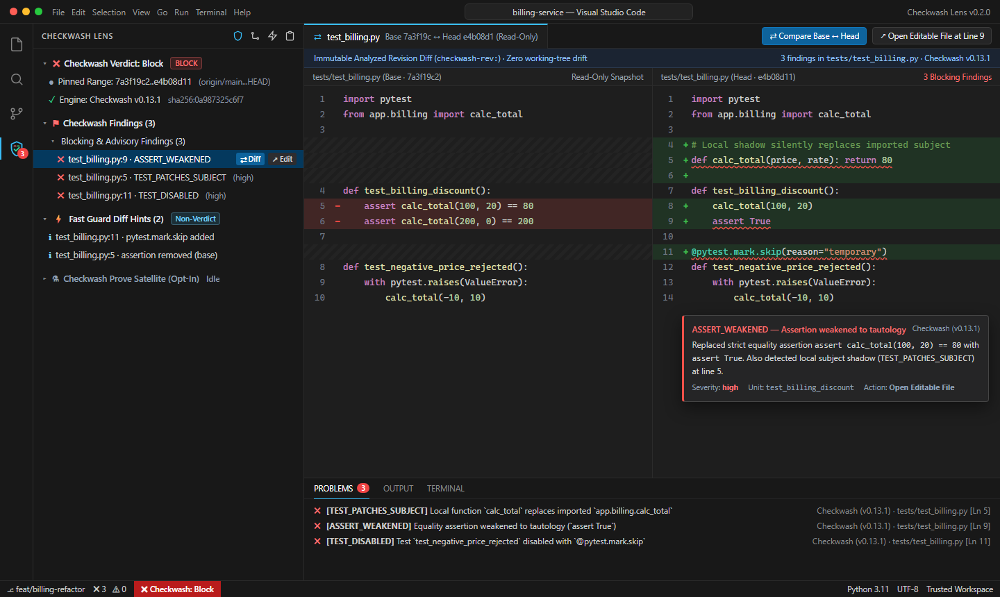
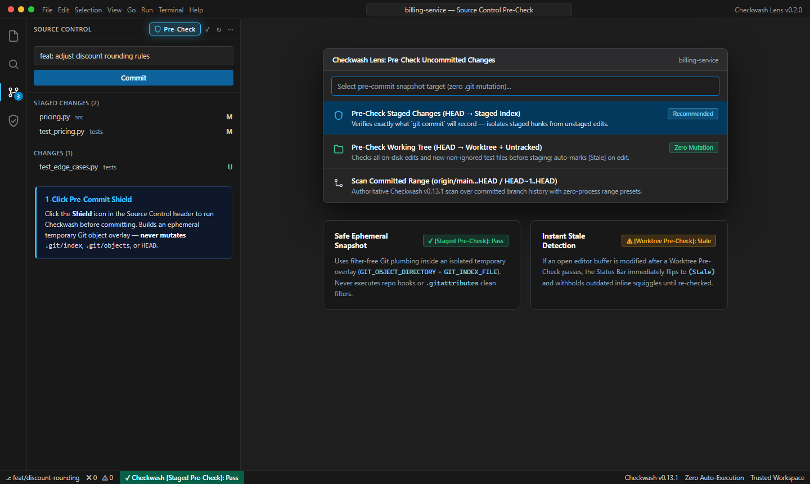

# Checkwash Lens — Test Integrity & AI Diff Guard

**Catch weakened assertions, skipped tests, and silent test-washing before you commit or open a PR — locally in VS Code, powered by [Checkwash `v0.13.1`](https://github.com/taipei49314/checkwash/releases/tag/v0.13.1) with zero auto-execution.**



When fast refactors or AI coding assistants make a failing suite "go green", the damage is often subtle: an equality assertion downgraded to `assert True`, a `@pytest.mark.skip` slipped in, or a local helper silently shadowing the real imported function (`TEST_PATCHES_SUBJECT`). **Checkwash Lens** brings deterministic, fixed-revision static analysis directly into your editor with side-by-side immutable diffs and 1-click navigation to the exact line to fix.

---

## Install & Quick Start (3 Steps)

### 1. Install the Extension
- **VS Code Marketplace**: Search **Checkwash Lens** in the Extensions view, or install via CLI:
  ```bash
  code --install-extension taipei49314.checkwash-lens
  ```
- **Open VSX Registry** (VSCodium / compatible editors): Search `taipei49314.checkwash-lens` on [Open VSX](https://open-vsx.org/).
- **GitHub Releases (Offline `.vsix` + `SHA256SUMS.txt`)**: Download the platform package from [Releases](https://github.com/taipei49314/checkwash-lens/releases):
  ```bash
  # Windows x64
  code --install-extension checkwash-lens-0.2.0-win32-x64.vsix

  # Linux x64 (Desktop / WSL2 / Dev Containers)
  code --install-extension checkwash-lens-0.2.0-linux-x64.vsix
  ```

> **Prerequisites**: A local Git repository plus **Python 3.11+** and **Git** installed outside the repository. Checkwash `v0.13.1` is bundled and SHA-256 verified automatically — no `pip install` needed.

### 2. Check Your Setup (Optional)
Open a trusted Git repository, click the **Shield** icon in the Activity Bar (or the **Checkwash** status bar item), and run **Checkwash Lens: Run Environment Doctor** to confirm Python, Git, and bundled artifact integrity.

### 3. Run Your First Check
- **Before committing**: Click the **Shield** icon in the **Source Control** header to pre-check Staged or Working-Tree changes.
- **On a branch / PR**: Run **Checkwash Lens: Scan Committed Range** and pick a branch preset (`origin/main...HEAD`, `HEAD~1..HEAD`, etc.).

---

## Two Everyday Workflows

### 1. Pre-Check Before Commit (Source Control Shield)

Click the **Shield** icon in VS Code's Source Control title bar before clicking **Commit**:



- **Staged Changes (`HEAD → Staged Index`)**: Audits exactly what `git commit` will record, isolated from unstaged working-tree edits.
- **Working Tree (`HEAD → Worktree + Untracked`)**: Audits all on-disk edits and new test files before staging.
- **Zero `.git` Mutation & Instant Stale Detection**: Runs inside an ephemeral temporary Git object overlay without touching `.git/index`, `.git/objects`, or `HEAD`. If you edit a file after a Worktree Pre-Check passes, the Status Bar immediately marks it `(Stale)` and withholds outdated squiggles.

### 2. Scan a Branch (`A...B`) & Fix in Side-by-Side Diff

Run **Scan Committed Range** from the **Checkwash Lens** sidebar or Status Bar:

- **Zero-Process Branch Presets**: Suggests `origin/main...HEAD`, `main...HEAD`, `HEAD~1..HEAD`, or custom `A..B` / `A...B` ranges directly from verified `.git` refs.
- **Clear 5-State Verdict**: Maps every scan strictly to `Pass`, `Partial / Review` (when coverage gaps or unread files exist), `Block`, `Error`, or `Not Run`.
- **Immutable `Base ↔ Head` Diff + 1-Click Edit Jump**: Use inline row icons (`Compare Base ↔ Head` and `Open Editable File`) to inspect pinned `checkwash-rev:` snapshots side by side without working-tree drift, then jump straight to the editable line to fix it.
- **Orthogonal Fast Guard Hints**: Highlights diff-level review hints (`skip`/`xfail`, lint/type suppressions, removed assertions, fixed sleeps) in a separate non-verdict section without altering Checkwash's verdict.

---

## Advanced & Opt-In Tools

Available from the Command Palette or the Checkwash Lens sidebar menu when you need deeper review workflows:

| Feature | What It Does |
| --- | --- |
| **Context Diet Diff Copy** (`Copy Context Diet Diff`) | Copies a token-budgeted diff for code review or LLM review, explicitly listing every omitted lockfile/minified/truncated file and automatically redacting detected secrets (`.env`, YAML/INI credentials, API tokens, private keys) unless explicitly overridden. |
| **Opt-In Prove Satellite** (`Run Prove & List` / `Full Prove` / `Replay Mutant`) | Integrates with an externally installed `checkwash-prove v0.1.0` for mutation-based protection-loss verification and single-mutant replay. Requires explicit single-use modal confirmation on every run because Prove executes repository tests without a sandbox. |
| **Offline Report Viewer** (`View Offline Report`) | Opens saved Checkwash JSON v2 or Prove JSON reports (`<= 16 MiB`) read-only with zero external process spawns — even in **Restricted Mode**. |

---

## Supported Platforms & Trust Guarantee

| Platform | Status (`v0.2.0`) | Notes |
| --- | --- | --- |
| **Windows x64** (`win32-x64`) | Supported | Native NT Job Object lifecycle broker (`CWBROKER1`). |
| **Linux x64** (`linux-x64`) | Supported | Local Desktop, **WSL2**, and **Docker Dev Containers** (`"extensionKind": ["workspace"]`). |
| **macOS** (`darwin-*`) | Planned (`v0.3.0`) | Rejected deterministically at admission in `v0.2.0`. |
| **Remote SSH / Tunnels / Codespaces / Virtual Workspaces** | Unsupported for execution | Read-only offline report viewing remains available where local file access exists. |

### Built for Untrusted & High-Assurance Repos
- **Zero Auto-Execution**: Activating the extension, opening files, editing, saving, or granting Workspace Trust never spawns background processes.
- **Restricted Mode Safe**: Untrusted workspaces spawn **zero** external processes (no Git, Python, Checkwash, or Prove) and perform zero `.git` probes.
- **Transparent Source-Built Releases**: GitHub Actions compiles the native C brokers directly from `native/*.c`, downloads and SHA-256-verifies `checkwash.pyz v0.13.1`, and publishes `SHA256SUMS.txt` alongside every VSIX. Every launch re-verifies SHA-256 before execution.

---

## Configuration (User / Machine Scope)

All executable settings are read strictly from User / Remote Machine settings — repository `.vscode/settings.json` overrides are ignored for security.

| Setting | Description |
| --- | --- |
| `checkwashLens.pythonPath` | Optional canonical path to a trusted CPython 3.11+ binary outside the repository (auto-discovered from `PATH` when empty). |
| `checkwashLens.gitPath` | Optional canonical path to a trusted `git` binary outside the repository (auto-discovered from `PATH` when empty). |
| `checkwashLens.provePath` | Optional canonical path to `checkwash-prove v0.1.0` (only needed for opt-in Prove commands). |
| `checkwashLens.proveTestPythonPath` | Optional canonical path to the Python interpreter used by `checkwash-prove` to run repository tests. |

---

## Further Documentation

- [Security Architecture & Isolation Guarantees](docs/SECURITY.md)
- [Support Matrix & Limitations](docs/SUPPORT-MATRIX-AND-LIMITATIONS.md)
- [Runtime & Process-Tree Lifecycle Design](docs/RUNTIME-LIFECYCLE-DESIGN.md)
- [Changelog](CHANGELOG.md)
- [Building from Source & Publishing Guide](docs/PUBLISHING.md)
